<div align="center">

# ⚡ NEXUSPAY
### The Autonomous Agent Commerce, Smart Escrow & Clearinghouse for PayPal
#### Built with the Complete Hackathon Sponsor Suite

[](LICENSE)
[](https://developer.paypal.com)
[](https://www.ag-grid.com)
[](https://bryntum.com)
[](https://channel3.ai)
[](https://elastic.co)
[](https://postman.com)
[](https://apimatic.io)
[](https://render.com)

**PayPal AI Hackathon: Build what’s next with PayPal and AI**

---

### *“What happens when you put AI behind the wheel of money?”*
**NexusPay** solves the hardest problem in the emergent Agentic Economy:  
**Zero-Trust Multi-Agent Settlements, Milestone-Gated Smart Escrow, and Sub-Second AI Dispute Arbitration.**

</div>

---

## 🏆 Unified Sponsor Suite Integrations

Every single hackathon sponsor has been deeply and meaningfully integrated into this single super app:

| Sponsor | Executive Judge | NexusPay Integration | Dedicated Award Target |
|---|---|---|---|
| **PayPal** | Jo Franchetti, Eddie Jaoude, Marco Podien, Karthik Ravi, Himraj Singh, Nathaniel Olson | Real Orders v2, Payouts v1, Refunds, Webhooks & official `@paypal/react-paypal-js` Buttons | **1st Place Grand Prize ($12,000)** & **Best Use of PayPal + AI ($5,000)** |
| **AG Grid** | Sylwia Vargas (Senior Technical Community Manager) | Enterprise-grade reactive telemetry, custom SVG risk gauges, sub-millisecond filtering, live tick streaming, circuit breakers | **Best Use of AG Grid - 1st Place ($5,000)** |
| **Bryntum** | Mats Bryntse (CEO) | Interactive Milestone Gantt & Scheduler with task dependencies, critical path, SLA deadlines & PayPal disbursement triggers | **Best Use of Bryntum ($1,000 x 3)** |
| **Channel3** | Ignacio Valdez Bicard (Founding Engineer) | Real-time AI agent commerce & compute catalog with spot pricing and instant 1-click RFQ dispatch to buyer agents | **Best Use of Channel3 ($1,500)** |
| **Elastic** | Carly Richmond (Senior Manager, Developer Advocacy) | Elasticsearch Query DSL simulator with vector search, SLA breach analysis, and telemetry anomaly scoring | **Impact / Technical Innovation** |
| **Postman** | Pooja Mistry (Sr. Developer Advocate) | Exportable Postman Collection v2.1 (`nexuspay_postman_collection.json`) + In-app Live API Request Runner | **Developer Experience** |
| **APIMatic** | Ameer Hassan (Co-Founder) | Certified OpenAPI 3.1 schema & root `apimatic.json` for 1-click SDK generation in Python, TypeScript, Java, and Go | **Best Use of APIMatic ($1,000 x 3)** |
| **Render** | Shifra Williams (Founding DevRel Engineer) | Production `render.yaml` infrastructure-as-code and multi-stage Docker container | **Best Use of Render ($1,000 Credits)** |

---

## 💡 The Hardest Problem Solved

In 2026, autonomous AI agents are everywhere — restocking inventory, procuring high-performance GPU clusters, hiring freelance security researchers, and trading real-time data feeds.

However, companies face an impossible dilemma:
1. **The Unbounded Risk Problem**: Giving an autonomous AI agent an unrestricted corporate card or PayPal wallet is financial suicide. If an agent loops, hallucinates, or gets prompt-injected, thousands of dollars can be drained in seconds.
2. **The Multi-Agent Zero-Trust Gap**: When Buyer Agent (*Atlas*) hires Supplier Agent (*Hermes*), how do they agree on pricing, milestones, and verifiable delivery proofs without human attorneys?
3. **The 14-Day Dispute Lag**: Traditional payment disputes take weeks of manual human paperwork. If an autonomous supplier agent delivers corrupted weights or breaches a latency SLA, an autonomous buyer needs **sub-second legal-financial arbitration**.

### Enter NexusPay:
- **Cryptographic Spend Covenants**: Human CFOs sign dynamic policy envelopes (budget ceilings, required escrow percentages, max single tranche).
- **Channel3 Dynamic Catalog**: Buyer agents discover vetted suppliers and compute clusters with real-time spot pricing.
- **Autonomous Multi-Agent Negotiation**: Buyer and Supplier agents negotiate specifications, SLA covenants, and milestone payment schedules in real-time.
- **PayPal Smart Escrow & Milestone Settlement**: Funds are locked via **PayPal Orders v2 API** and conditionally disbursed tranche-by-tranche via **PayPal Payouts v1 API** only upon cryptographic deliverable verification (CUDA hashes, SHA-256 signatures).
- **Bryntum Milestone Schedule**: Visualizes task dependencies, critical path, and SLA disbursement milestones.
- **Themis: Autonomous AI Arbiter**: Reviews machine-readable telemetry, calculates proportional fault, and instantly triggers automated refunds via **PayPal Refund API**.
- **Elastic Telemetry Intelligence**: Full-text and vector anomaly search over historical contracts and SLA logs.
- **Mission Control with AG Grid**: Enterprise treasury console powered by AG Grid with sub-millisecond filtering, live risk heatmaps, anomaly detection, and one-click agent freeze circuit breakers.
- **Postman & APIMatic DevHub**: One-click Postman collection export and multi-language SDK generator.

---

## 🏛️ System Architecture

```mermaid
sequenceDiagram
    autonumber
    actor CFO as Enterprise CFO
    participant Atlas as Buyer Agent (Atlas)
    participant Channel3 as Channel3 Catalog
    participant Hermes as Supplier Agent (Hermes)
    participant Escrow as NexusPay Escrow Vault
    participant PayPal as PayPal Developer Rails
    participant Bryntum as Bryntum Gantt
    participant Themis as Themis AI Arbiter
    participant Elastic as Elastic Vector Search
    participant Grid as AG Grid Telemetry

    CFO->>Atlas: Delegate Signed Spend Mandate ($2,400 max, 99.9% SLA)
    Atlas->>Channel3: Query Dynamic Compute Catalog (H100 Clusters)
    Channel3-->>Atlas: Spot Price & Supplier Profiles
    Atlas->>Hermes: Broadcast RFQ (Specifications & Escrow Requirement)
    Hermes-->>Atlas: Dynamic Counter-Offer ($2,208 total, 3 Milestones)
    Atlas->>Hermes: Sign Cryptographic Agreement (SHA-256)
    Atlas->>PayPal: Initialize Escrow Hold (PayPal Orders v2 API)
    PayPal-->>Escrow: Funds Locked (CAPTURE)
    Escrow->>Bryntum: Generate Milestone Gantt & Critical Path
    Grid->>Grid: Ingest Order & Stream AG Grid Telemetry

    rect rgb(20, 30, 45)
        Note over Hermes,PayPal: Milestone 1: Provisioning & CUDA Benchmark
        Hermes->>Escrow: Submit Verifiable Proof (CUDA Hash)
        Escrow->>PayPal: Execute Milestone Payout (PayPal Payouts v1 API)
        PayPal-->>Hermes: Payout Batch Settled ($552.00 released)
    end

    rect rgb(45, 20, 25)
        Note over Hermes,Themis: Milestone 2: SLA Latency Breach Anomaly
        Hermes->>Elastic: Telemetry Anomaly Ingest (184ms vs 35ms ceiling)
        Elastic->>Themis: Vector Anomaly Score Alert (0.92 Critical)
        Themis->>Themis: Legal-Financial Reasoning (45% Breach Clawback)
        Themis->>PayPal: Trigger Partial Refund (PayPal Refund API)
        Themis->>PayPal: Release Partial Sunk Cost (PayPal Payouts v1)
        PayPal-->>Atlas: $483.75 Refunded to Buyer
        PayPal-->>Hermes: $591.25 Released to Supplier
    end
```



---

## ⚡ Quickstart Guide (Run in 60 Seconds)

### Prerequisites
- Node.js 18+ & npm

### 1. Clone & Install
```bash
git clone https://github.com/HirthikBalaji/nexuspay-autonomous-commerce.git
cd nexuspay-autonomous-commerce
npm install
```

### 2. Run the Application
```bash
npm run dev
```
Open your browser at **`http://localhost:3000`** (or **`http://localhost:5000`** in production).

### 3. Production Build & Start
```bash
npm run build
npm start
```

---

## 🧪 Testing with Real PayPal Sandbox Credentials

1. Open **Settings (gear icon)** in the top right navbar.
2. Enter your PayPal Developer **Sandbox Client ID** and **Client Secret**.
3. Click **Test Ping** to test live round-trip latency to `https://api-m.sandbox.paypal.com`.
4. Click **Save Configuration**. Orders and payouts will immediately execute against PayPal's live sandbox servers!

---

## 📄 License
This project is open source and available under the [MIT License](LICENSE).
