<div align="center">

# ⚡ NEXUSPAY
### The Autonomous Agent Commerce, Smart Escrow & Clearinghouse for PayPal

[](LICENSE)
[](https://developer.paypal.com)
[](https://www.ag-grid.com)
[](https://www.apimatic.io)
[](https://render.com)

**Built for the PayPal AI Hackathon: Build what’s next with PayPal and AI**

---

### *“What happens when you put AI behind the wheel of money?”*
**NexusPay** solves the single hardest problem in the emergent Agentic Economy:  
**Zero-Trust Multi-Agent Settlements, Milestone-Gated Smart Escrow, and Sub-Second AI Dispute Arbitration.**

</div>

---

## 🏆 Targeted Award Categories

1. **Overall 1st Place Grand Prize ($12,000)**
2. **Best Use of Agentic Commerce ($5,000)**
3. **Best Use of PayPal + AI ($5,000)**
4. **Best Use of AG Grid - 1st Place ($5,000)**
5. **Best Use of APIMatic ($1,000)**
6. **Best Use of Render ($1,000 Credits)**
7. **Most Impactful & Best Demo Delivery**

---

## 💡 The Hardest Problem: Why Autonomous Agent Commerce Breaks Today

In 2026, autonomous AI agents are everywhere — restocking inventory, procuring high-performance cloud compute clusters, hiring freelance security researchers, and trading real-time oracle datasets.

However, companies face an impossible dilemma:
1. **The Unbounded Risk Problem**: Giving an autonomous AI agent an unrestricted corporate card or PayPal balance is financial suicide. If an agent loops, hallucinates, or gets prompt-injected, thousands of dollars can be drained in seconds.
2. **The Multi-Agent Zero-Trust Gap**: When Buyer Agent (*Atlas*) hires Supplier Agent (*Hermes*), how do they agree on pricing, milestones, and verifiable delivery proofs without human attorneys?
3. **The 14-Day Dispute Lag**: Traditional payment disputes take weeks of manual human paperwork. If an autonomous supplier agent delivers corrupted weights or breaches a latency SLA, an autonomous buyer needs **sub-second legal-financial arbitration**.

### Enter NexusPay:
NexusPay acts as the **Autonomous Clearinghouse & Escrow Protocol** connecting AI agents to PayPal's financial rails:
- **Cryptographic Spend Covenants**: Human CFOs sign dynamic policy envelopes (budget ceilings, required escrow percentages, max single tranche).
- **Autonomous Multi-Agent Negotiation**: Buyer and Supplier agents negotiate specifications, SLA covenants, and milestone payment schedules in real-time.
- **PayPal Smart Escrow & Milestone Settlement**: Funds are locked via **PayPal Orders v2 API** and conditionally disbursed tranche-by-tranche via **PayPal Payouts v1 API** only upon cryptographic deliverable verification (CUDA hashes, SHA-256 signatures).
- **Themis: Autonomous AI Arbiter**: In the event of an SLA breach or corrupted deliverable, Themis AI Arbiter reviews machine-readable telemetry, calculates proportional fault, and instantly triggers automated refunds via **PayPal Refund API**.
- **Mission Control with AG Grid**: Enterprise treasury console powered by AG Grid with sub-millisecond filtering, live risk heatmaps, anomaly detection, and one-click agent freeze circuit breakers.

---

## 🏛️ System Architecture

```mermaid
sequenceDiagram
    autonumber
    actor CFO as Enterprise CFO
    participant Atlas as Buyer Agent (Atlas)
    participant Hermes as Supplier Agent (Hermes)
    participant Escrow as NexusPay Escrow Vault
    participant PayPal as PayPal Developer Rails
    participant Themis as Themis AI Arbiter
    participant Grid as AG Grid Telemetry

    CFO->>Atlas: Delegate Signed Spend Mandate ($2,400 max, 99.9% SLA)
    Atlas->>Hermes: Broadcast RFQ (Specifications & Escrow Requirement)
    Hermes-->>Atlas: Dynamic Counter-Offer ($2,208 total, 3 Milestones)
    Atlas->>Hermes: Sign Cryptographic Agreement (SHA-256)
    Atlas->>PayPal: Initialize Escrow Hold (PayPal Orders v2 API)
    PayPal-->>Escrow: Funds Locked (CAPTURE)
    Grid->>Grid: Ingest Order & Update Treasury Telemetry

    rect rgb(20, 30, 45)
        Note over Hermes,PayPal: Milestone 1: Provisioning & CUDA Benchmark
        Hermes->>Escrow: Submit Verifiable Proof (CUDA Hash)
        Escrow->>PayPal: Execute Milestone Payout (PayPal Payouts v1 API)
        PayPal-->>Hermes: Payout Batch Settled ($552.00 released)
    end

    rect rgb(45, 20, 25)
        Note over Hermes,Themis: Milestone 2: SLA Latency Breach Anomaly
        Hermes->>Escrow: Telemetry Alert (184ms vs 35ms ceiling)
        Escrow->>Themis: Escalate Dispute with Machine Logs
        Themis->>Themis: Legal-Financial Reasoning (45% Breach Clawback)
        Themis->>PayPal: Trigger Partial Refund (PayPal Refund API)
        Themis->>PayPal: Release Partial Sunk Cost (PayPal Payouts v1)
        PayPal-->>Atlas: $483.75 Refunded to Buyer
        PayPal-->>Hermes: $591.25 Released to Supplier
    end
```



---

## 🚀 Key Features & Innovations

### 1. Multi-Agent Negotiation Arena
- Visual conversational room between Buyer Agent (**Atlas**) and Supplier Agent (**Hermes**).
- Real-time exchange of structured proposals: RFQ $\rightarrow$ Counter $\rightarrow$ Policy Convergence $\rightarrow$ Contract Signing.
- Dynamic price convergence within budget constraints and cryptographic SHA-256 contract hashing.

### 2. PayPal Developer Rails Integration
- **PayPal Orders v2 API** (`/v2/checkout/orders`): Creates escrow intent and captures deposited funds into the secure vault.
- **PayPal Payouts v1 API** (`/v1/payments/payouts`): Dispatches instant conditional milestone tranches directly to beneficiary agent PayPal wallets.
- **PayPal Payments Refund API** (`/v2/payments/captures/{id}/refund`): Executes automated arbitration refunds.
- **PayPal Webhook Event Stream**: Real-time listener and simulator tracking `CHECKOUT.ORDER.APPROVED`, `PAYMENT.CAPTURE.COMPLETED`, `PAYMENT.PAYOUTSBATCH.SUCCESS`, and `CUSTOMER.DISPUTE.RESOLVED`.
- **Zero-Friction Sandbox**: Supports custom PayPal Sandbox client credentials OR instant interactive simulation mode out of the box!

### 3. Themis: Autonomous AI Arbiter
- Solves the dispute bottleneck in agentic commerce.
- Compares signed contract covenants against multimodal telemetry (latency benchmarks, test suites, SHA-256 hashes).
- Issues reasoned legal-financial decrees with confidence scores and automated PayPal execution.

### 4. AG Grid Enterprise-Grade Fleet Telemetry
- High-density, real-time reactive transaction grid powered by **AG Grid v36**.
- Features:
  - Custom Risk Score Gauge renderer (Green/Amber/Red pulsing indicators).
  - Milestone Progress renderer and quick filter search.
  - Row Action circuit breakers: **Instant Emergency Freeze** to pause rogue agent spending.
  - CSV/JSON export capability.

### 5. APIMatic & OpenAPI 3.1 Ready
- Clean, 100% compliant **OpenAPI 3.1 specification** at `/api/docs/openapi.json`.
- Root `apimatic.json` configuration file enabling 1-click SDK generation for Python, TypeScript, Java, and Go via APIMatic Context Plugins.
- Postman Collection compatible.

---

## 🎬 3-Minute Demo Video Script

| Time | Visual | Narration / Action |
|---|---|---|
| **0:00 - 0:35** | Hero Banner & Problem Statement | *"Autonomous AI agents are revolutionizing commerce, but giving an agent an open corporate wallet is terrifying. What happens when an agent loops, overpays, or gets scammed? Welcome to NexusPay — the trust and smart escrow protocol for the autonomous agent economy, built on PayPal developer rails."* |
| **0:35 - 1:15** | Negotiation Arena | *"Click 'Launch Agent Negotiation'. Watch Atlas (Buyer Agent) and Hermes (Supplier Agent) negotiate an H100 GPU compute contract. They converge on pricing, agree to 3 milestone tranches, and cryptographically seal the contract with a SHA-256 hash."* |
| **1:15 - 1:55** | PayPal Smart Escrow & Milestone Payout | *"Next, the contract initializes a PayPal Orders v2 escrow lock. When Milestone 1 completes with a verifiable benchmark hash, the verifier automatically triggers the PayPal Payouts v1 API — releasing $552.00 instantly to Hermes's PayPal wallet."* |
| **1:55 - 2:35** | Themis AI Arbiter Dispute | *"Now let's simulate an adversarial scenario: on Milestone 2, an SLA breach occurs — latency spikes to 184ms. Themis AI Arbiter immediately convenes, compares the telemetry against Contract Clause 4.2, and enforces a binding 45% refund to the buyer via PayPal Refund API and a 55% partial payout to the supplier."* |
| **2:35 - 3:00** | AG Grid Telemetry & Circuit Breaker | *"Finally, look at our AG Grid Enterprise Telemetry console. CFOs monitor 20+ streaming agent transactions with live risk gauges, sub-millisecond filtering, and an Emergency Panic Freeze circuit breaker to instantly halt any rogue agent. NexusPay brings safety, liquidity, and intelligence to autonomous commerce."* |

---

## 🛠️ Tech Stack

- **Frontend**: React 18, Vite 5, Tailwind CSS, AG Grid Community & Enterprise Theme (`ag-grid-react` v36), Lucide Icons, Canvas Confetti.
- **Backend**: Node.js, Express, Axios, Dotenv, Crypto.
- **PayPal APIs**: PayPal Orders v2, PayPal Payouts v1, PayPal Payments Refund v2, PayPal Webhooks.
- **Sponsors & Standards**: AG Grid v36, APIMatic Context Plugin (`apimatic.json`), OpenAPI 3.1, Render (`render.yaml`), Docker.

---

## ⚡ Quickstart Guide (Run in 60 Seconds)

### Prerequisites
- Node.js 18+ & npm

### 1. Clone & Install
```bash
git clone https://github.com/HirthikBalaji/nexuspay-autonomous-commerce.git
cd nexuspay-autonomous-commerce
npm install
```

### 2. Run the Application
```bash
npm run dev
```
Open your browser at **`http://localhost:3000`** (or **`http://localhost:5000`** in production).

### 3. Production Build & Start
```bash
npm run build
npm start
```

---

## 🧪 Testing with PayPal Sandbox Credentials

By default, NexusPay boots into **Interactive High-Fidelity Simulation Mode** so judges and evaluators can experience 100% of the functionality without needing to generate sandbox test accounts.

To connect your real PayPal Developer Sandbox account:
1. Click the **Settings (gear icon)** in the top right navbar.
2. Enter your PayPal Developer **Sandbox Client ID** and **Client Secret**.
3. Toggle "Interactive Simulation Mode" off.
4. Click **Save PayPal Configuration**. All orders, captures, and payouts will now route directly to `https://api-m.sandbox.paypal.com`!

---

## 📄 License
This project is open source and available under the [MIT License](LICENSE).
